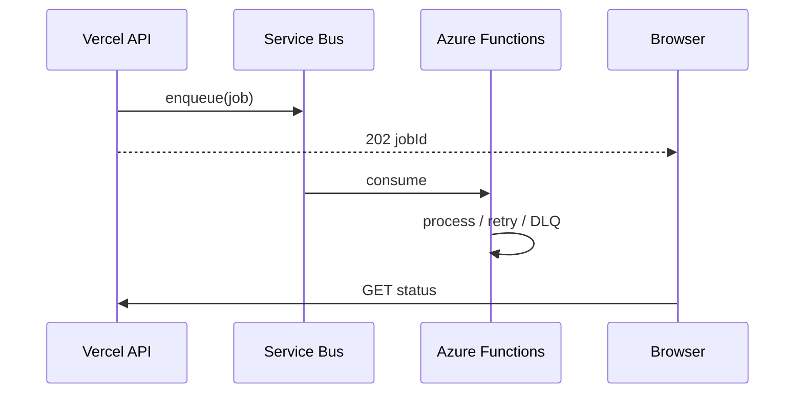

# Flujos asíncronos

Estados: pendiente, en cola, ejecutando, esperando integración, esperando revisión, finalizado, fallido, cancelado.

Sin Service Bus, `POST /secop/sync` ejecuta un lote limitado en línea y lo declara como tal.
