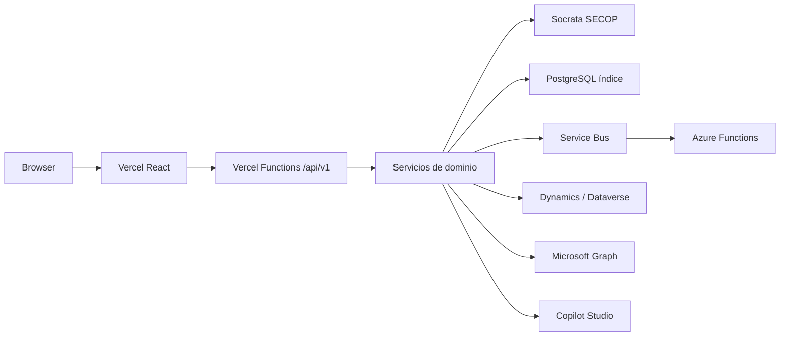

# Arquitectura backend TenderOps

Vercel atiende HTTP corto. Azure Functions atiende sync, documentos y orquestación. El núcleo TypeScript vive en `packages/backend` y lo consumen `api/v1/[...path].ts` y `workers/`.

El backend .NET existente (`src/TenderOps.*`) se conserva. Esta entrega añade la API TypeScript exigida para Vercel + SECOP real.

## Paquetes

- `packages/backend` — config, SoQL, mappers, búsqueda, dominio, integraciones, HTTP
- `api/` — función Vercel
- `workers/` — disparadores programados
- `frontend/` — UI; Explorar consulta `/api/v1/secop/processes` y cae al lote demo si la API no está
